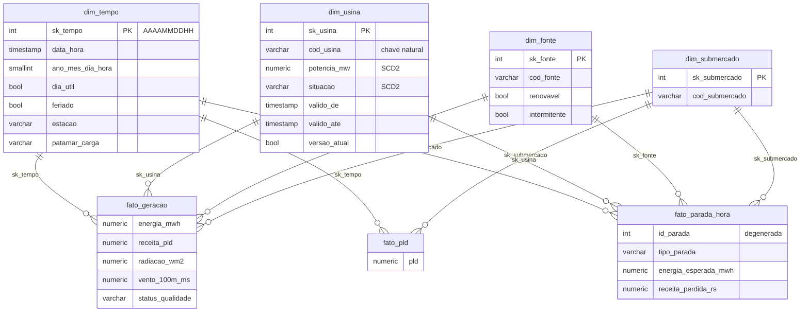

# Modelagem dimensional: DW Campo Real Energia

Schema `dw` no PostgreSQL. DDL em [`dw/01_ddl.sql`](../dw/01_ddl.sql), carga em [`dw/02_carga.sql`](../dw/02_carga.sql),
views de apoio em [`dw/03_views.sql`](../dw/03_views.sql). Executar com `python dw/carregar_dw.py`.

## 1. Camadas

```
campo_real_energia (origem, só leitura) ─┐
raw.* (CCEE e Open-Meteo como chegaram)  ─┼─> tratada.* / stg.* (tipado, limpo) ──> dw.* (star schema) ──> Power BI
qualidade.* (métricas, decisões, impacto) ┘
```

## 2. Matriz de barramento

| Processo de negócio | Fato | Tempo | Usina | Fonte | Submercado |
|---|---|:-:|:-:|:-:|:-:|
| Geração de energia (+ clima) | `fato_geracao` | ✔ | ✔ | ✔ | ✔ |
| Formação de preço (PLD) | `fato_pld` | ✔ | | | ✔ |
| Indisponibilidade (paradas) | `fato_parada_hora` | ✔ | ✔ | ✔ | ✔ |
| Qualidade de dados | `fato_qualidade`, `fato_impacto` | (data da execução) | | | |

`dim_tempo` e `dim_submercado` são **dimensões conformadas**: as mesmas chaves ligam geração e preço, o que
permite calcular a receita valorada (geração da hora × PLD da hora no submercado da usina).

## 3. Grão de cada fato (declarado antes da criação)

| Fato | Grão | Medidas |
|---|---|---|
| `fato_geracao` | 1 usina × 1 hora medida | energia_mwh, disponibilidade_mw, potencia_mw, pld, receita_pld, clima (radiação, vento, temperatura, chuva, nuvens) |
| `fato_pld` | 1 submercado × 1 hora | pld (R$/MWh) |
| `fato_parada_hora` | 1 usina × 1 hora dentro de uma parada | energia_esperada_mwh, pld, receita_perdida_rs |
| `fato_qualidade` | 1 regra × 1 fase (origem/stg) × 1 execução | avaliados, falhas, pct_conformidade |
| `fato_impacto` | 1 indicador × 1 recorte × 1 execução | antes, depois, diferença, variação % |

O grão de `medicao_geracao` (usina × hora) é **diferente** do grão do PLD (submercado × hora). Por isso o PLD tem
fato próprio, e o valor da hora é levado para `fato_geracao` pela usina → submercado (coluna `pld` e medida
derivada `receita_pld`, documentadas como desnormalização para simplificar o painel).

## 4. Diagrama



## 5. Dimensões

**Por que usina, fonte e submercado são dimensões separadas (e não uma só):**
- `submercado` é conformada: filtra a geração **e** o PLD. Se fosse atributo da usina, `fato_pld` não teria como se
  ligar a ela.
- `fonte` é a principal forma de corte do negócio (P1, P3, P4) e tem atributos próprios (renovável, intermitente).
  Como a fonte e o submercado de uma usina podem mudar de versão (SCD2), gravar `sk_fonte` e `sk_submercado`
  direto no fato preserva o valor vigente em cada hora sem precisar atravessar `dim_usina`.
- O modelo continua **estrela** (não floco de neve): os fatos apontam diretamente para as quatro dimensões.

**Chaves substitutas:** todas as dimensões usam inteiros gerados (`IDENTITY`). A exceção é `dim_tempo`, com
`sk_tempo = AAAAMMDDHH` (inteiro legível e ordenável). As chaves naturais (`cod_usina`, `cod_fonte`,
`cod_submercado`) ficam na dimensão; o fato só guarda a chave substituta.

**Membro desconhecido:** cada dimensão tem a linha `-1` ("Desconhecido", "N/D"). Toda busca de chave no carregamento
usa `COALESCE(..., -1)`, então nenhum fato é perdido por falta de correspondência e o problema fica visível
no painel. A checagem do `carregar_dw.py` conta quantos fatos caíram no `-1` (hoje: zero, porque a limpeza
isolou as medições sem usina em `qualidade.quarentena`).

### dim_tempo

Construída pelo grupo no SQL com `generate_series`, hora a hora, de 2025-01-01 a 2026-12-31 (cobre medição e PLD).

| Atributo | Regra |
|---|---|
| dia_util | Não é sábado, domingo, feriado nem ponto facultativo |
| feriado / ponto_facultativo / nome_feriado | `stg.feriado`: 2025 da origem; 2026 calculado (datas fixas + móveis pela Páscoa), porque a origem não cobre 2026 |
| estacao | Hemisfério sul: verão 21/12–19/03, outono 20/03–20/06, inverno 21/06–21/09, primavera 22/09–20/12 |
| periodo_hidrologico | Úmido (nov–abr) / Seco (mai–out) |
| patamar_carga | Simplificação: dia útil leve 0–6h, pesada 18–20h, média no resto; sábado leve 0–6h e média no resto; domingo/feriado média 17–21h e leve no resto |
| horario_ponta | 18h–20h em dia útil |

### dim_usina: SCD

| Atributo | Tipo | Justificativa |
|---|---|---|
| nome, potencia_mw, situacao, cod_fonte, cod_submercado | **Tipo 2** (nova versão) | Mudam o significado dos números. Se a potência aumentar (repotenciação), o fator de capacidade de 2025 precisa continuar usando a potência antiga; se a usina for desativada, o histórico de geração não pode "sumir". |
| uf, municipio, latitude, longitude, data_inicio_operacao, flag_qualidade | **Tipo 1** (sobrescreve) | Na prática só mudam por **correção de cadastro** (ex.: latitude com sinal trocado). Guardar a versão errada não tem valor analítico. |

Implementação ([`02_carga.sql`](../dw/02_carga.sql)): um `md5` dos atributos tipo 2 é comparado a cada carga.
Se mudou, a versão atual recebe `valido_ate = agora` e `versao_atual = false`, e uma nova versão entra com
`valido_de = agora`. Os fatos escolhem a versão com `data_hora >= valido_de AND data_hora < valido_ate`.
A primeira versão vale desde 1900-01-01, pois os dados históricos são anteriores à primeira carga.
Testado alterando a potência da UHE-001 numa transação desfeita: a versão antiga foi fechada, a nova foi
aberta e as horas de 2025 continuaram ligadas à versão de 180 MW.

## 6. Granularidades diferentes

| Dado | Granularidade | Tratamento |
|---|---|---|
| Medição, PLD, clima | Horária | Mesmo grão de `dim_tempo`; ligação direta por `sk_tempo` |
| Feriados | Diária | Propagado para as 24 horas do dia como atributo de `dim_tempo` |
| Paradas | Intervalo (início/fim) | Explodido em horas (`generate_series`) em `fato_parada_hora` |
| Cadastro de usina | Cadastral, muda raramente | `dim_usina` com SCD2; a versão é escolhida pela hora do fato |
| Visões diária/mensal | Agregação | Views `vw_geracao_diaria` e `vw_geracao_mensal`, calculadas a partir do grão horário (nunca o contrário) |

**Ponto de clima × usina:** a Open-Meteo foi consultada nas coordenadas exatas de cada usina (já corrigidas na
etapa de qualidade), então a relação é 1:1 e o clima entra como atributo de `fato_geracao`, no mesmo grão
usina × hora. Se a fonte fosse uma estação do INMET, a associação seria pela estação mais próxima (distância
haversine), registrada numa ponte usina → estação.

## 7. Estimativa das perdas por parada

Para cada hora de parada: energia esperada = média da energia da mesma usina, na mesma hora do dia e no mesmo mês,
usando só horas fora de parada. Receita não realizada = energia esperada × PLD da hora no submercado.
Quando a parada cobre o mês inteiro (entressafra da biomassa, dez/2025), não há base de comparação no mesmo mês:
a estimativa fica **nula** e o método registra o motivo, em vez de usar meses de safra e inventar uma perda.
